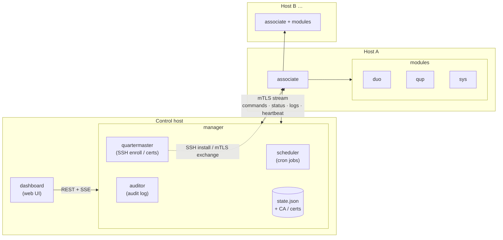

# LabAssistant

A lightweight dashboard + docker orchestrator + host updater + more. AI assisted, human designed and reviewed.

Ansible too complicated? PyInfra also too complicated? Portainer too bloated? LabAssistant is a lightweight replacement for some of those: a single pane of glass dashboard with the ability to orchestrate docker compose files, restart containers, update images, and edit those compose files directly on the host. While we're at it, it also notifies you of host package updates and applies them. See [DESIGN.md](DESIGN.md) for the full design and [API.md](API.md) for the module contract and manager API.

## Prerequisites

- **Go 1.26+** (only the manager build needs it; generated protobuf and dashboard assets are committed, so `buf` is **not** required to deploy)
- **tailscale** (optional — otherwise route/open ports between your hosts and the manager)

## Architecture



## Components

| Component | Role |
| --- | --- |
| **associate** | Per-host agent and sole entrypoint. Holds a persistent mTLS stream to the manager (status, heartbeat, log streaming), serializes commands in a queue, and elevates via a helper for privileged actions. |
| **manager** | The control host. Owns host/module state (`state.json`), the CA and issued certs, and the API the dashboard consumes. Derives liveness from the stream. |
| **dashboard** | Slim web UI (frontend for the manager API): host/container health, manual actions, add/remove hosts, scheduled tasks, compose-file editing (a form or raw YAML, with disable-by-commenting and validation) plus `.env` editing, log streaming, audit view, backup/restore, and login. |

The manager has three internal packages:

- **quartermaster** — negotiates SSH to install/upgrade associates, does the mTLS cert exchange, and watches cert expiry.
- **auditor** — hash-chained, non-sensitive audit log (logins, host/module/cert changes, approvals) to file, SQLite, or external DB with configurable retention.
- **scheduler** — cron jobs across one or many hosts with skip/catch-up/retry policy, confirmation for destructive tasks, and manager- or host-timezone scheduling.

Full detail for each lives in [DESIGN.md](DESIGN.md#components).

## Modules

Modules are the abilities an associate runs on a host (contract in [API.md](API.md); compiled
into the associate for v1).

| Module | Purpose |
| --- | --- |
| **duo** | **d**ocker **u**pdater/**o**rchestrator — image update checks (Watchtower-style), compose start/stop/restart, compose and `.env` file reads/writes for the editor, docker log streaming. On hosts without the `docker` CLI it stays empty; set `LABASSISTANT_DEMO=1` on the associate to seed demo stacks for a docker-less walkthrough. |
| **qup** | **q**uick **up**dater — dry-run + apply host package updates, distro-detected (Debian-based today). |
| **sys** | **sys**tem — host commands: logs, reboot (confirmed), interfaces, disk usage, uptime, service restarts. Reboot and service restarts act on the host on any OS: systemd or OpenRC on Linux, `shutdown` / `launchctl` on macOS (other OSes fail them). For local testing, set `LABASSISTANT_SYS_SIMULATE=1` on the associate to simulate them instead. The Hosts page shows `mode=real` or `mode=simulated`. |

More detail in [DESIGN.md](DESIGN.md#modules).

## Quick deploy (dev VM)

To stand up a manager on a fresh Debian-based VM for development/testing, run the deploy script.
It clones the repo, installs Go if needed, builds the manager, and installs the
`labassistant-manager` systemd service (enabled on boot, but not started — you set the dashboard
password first):

```bash
# on the VM
curl -fsSL https://raw.githubusercontent.com/thinkaliker/LabAssistant/main/scripts/deploy.sh -o deploy.sh
bash deploy.sh
```

Or from an existing checkout: `./scripts/deploy.sh`. Options: `--dir <checkout>`,
`--branch <branch>`, `--home <data-home>`, `--no-service` (skip the systemd unit). The service
runs as the invoking user; if `systemctl` isn't present the deploy skips it and you run the
manager by hand.

Then follow the printed next steps:

```bash
export LABASSISTANT_HOME="$HOME/.labassistant"
cd ~/LabAssistant
./scripts/manage.sh setpass   # set the dashboard login password
./scripts/manage.sh start     # start the service (already enabled on boot)
./scripts/manage.sh status    # check it; `logs -f` to follow
```

`manage.sh` wraps the whole lifecycle: `start`/`stop`/`restart`/`status`/`logs`,
`enable`/`disable`, `install-service`/`uninstall-service`, `build`/`update`, and `setpass`. It
calls `sudo systemctl` for you. `setpass` runs the manager binary against the *service's* home
(`$LABASSISTANT_HOME`, else `~/.labassistant`), so the password lands in the `settings.json` the
running service reads — always prefer it over `./bin/manager setpass` to avoid a home mismatch that
leaves the dashboard in open mode (no login/logout). (Deployed with `--no-service`? Run
`./bin/manager serve` directly instead — dashboard on :8080, associate mTLS on :8443.)

The deploy script installs a starter config at `$LABASSISTANT_HOME/config/config.toml` (copied
from [`config.sample.toml`](config.sample.toml); with the default home that's
`~/.labassistant/config/config.toml`). To serve the dashboard on a different port — e.g. when 8080
is already in use — edit `http_addr` there before `serve`:

```toml
http_addr = ":9090"
```

Unset fields keep their defaults, and the associate mTLS port (`grpc_addr`, `:8443`) is
independent, so enrolled hosts are unaffected. Deploying by hand instead of via the script? Just
create that file yourself — a missing config means all defaults.

### Rebuilding after code changes

The dashboard HTML/JS and generated protobuf are embedded into the manager binary, so any change
to Go code *or* the dashboard requires a rebuild and restart. With the systemd service installed,
use `manage.sh`:

```bash
cd ~/LabAssistant
./scripts/manage.sh build manager   # or `build all` for associate + helper too
./scripts/manage.sh restart         # restart under systemd
./scripts/manage.sh logs -f         # follow the journal
```

To pull, rebuild, and restart in one step: `./scripts/manage.sh update`. Running by hand
(`--no-service`) instead? `go build -o bin/manager ./cmd/manager`, then
`pkill -f 'bin/manager serve'` and `./bin/manager serve`.

`go test ./...` also runs the dashboard's JavaScript tests (`dashboard/jstest`, via
`node --test dashboard/jstest/`) when Node 22.7+ is installed, and skips them otherwise.

Open the dashboard at `http://<vm>:8080` (or whichever `http_addr` you set; for `https://`, see
[HTTPS](#https) below). To enroll a host without the SSH flow, mint a bundle
with `./bin/manager enroll -name <host>` (see [BUILD.md](BUILD.md)).

### HTTPS

The dashboard is plain HTTP until you give it a certificate. On a tailnet there are two ways;
both need MagicDNS and HTTPS certificates enabled in the Tailscale admin console (DNS page).

**Let Tailscale terminate TLS (simplest).** Tailscale fetches and renews a certificate for the
machine's `*.ts.net` name and proxies to the dashboard, so LabAssistant needs no TLS config:

```bash
sudo tailscale serve --bg 8080   # https://<machine>.<tailnet>.ts.net -> localhost:8080
```

Then set `http_addr = "127.0.0.1:8080"` in `config.toml` and restart, so the plain-HTTP port is
no longer reachable over the tailnet directly.

**Or have the manager serve HTTPS itself.** Point `tls_cert` and `tls_key` in `config.toml` at
PEM files, at the top level of the file, above any `[section]` header (TOML files keys below a
header into that section). `http_addr` then speaks HTTPS only, and the startup log says
`https listening`. The manager re-reads the files within ~30s of
them changing, so a renewal needs no restart. With Tailscale issuing the certificate:

```bash
mkdir -p ~/.labassistant/tls
sudo tailscale cert --cert-file ~/.labassistant/tls/dashboard.crt \
  --key-file ~/.labassistant/tls/dashboard.key <machine>.<tailnet>.ts.net
sudo chown "$USER" ~/.labassistant/tls/dashboard.*   # the manager runs as you, not root
```

```toml
tls_cert = "/home/<you>/.labassistant/tls/dashboard.crt"
tls_key  = "/home/<you>/.labassistant/tls/dashboard.key"
```

Tailscale certificates last 90 days, so re-run those `tailscale cert` and `chown` lines on a
schedule (a weekly root cron job is plenty). Any other CA's certificate works the same way.

### Install as an app

Over HTTPS (either way above) the dashboard is installable as an app (PWA): its own window, dock
or home-screen icon, no browser chrome. In Chrome or Edge use the install icon in the address bar
(or **Cast, save, and share → Install page as app**), on Android **Add to Home screen**, and in
Safari **Share → Add to Dock** (macOS) or **Add to Home Screen** (iOS). Browsers only allow this on
HTTPS (or `localhost`), so a plain `http://<vm>:8080` dashboard can't be installed. The app is
always live: nothing is cached, and if the manager is unreachable (restarting, updating) the window
shows a notice and reloads itself when it is back.

## Workflow

1. Install and run the manager — it becomes your control host and root CA.
2. Open the dashboard and add a host (SSH user; flag tailscale).
3. The quartermaster SSHes in, installs the associate, and exchanges mTLS certs.
4. The associate runs as a service, dials home over mTLS, and advertises its modules.
5. Trigger actions from the dashboard → manager → associate → module.

Step-by-step setup is in [DESIGN.md](DESIGN.md#workflow-and-setup).

## TODO

Known items not yet designed into the components above.

### Associate / modules

- Modules are compiled into the associate for v1; design toward external-binary modules later
  (the contract is already shaped for it).

### Future work (post-v1)

- Associate self-update: push a new associate/helper binary over the stream and swap+restart it
  (chunked transfer, atomic replace, restart). Deferred from v1.
- ntfy integration
- Webhooks for external notification.
- Home Assistant integration.
- Expand coverage over time: qup → more distros; duo → swarm/podman.
- Multiple managers on different hosts can connect to an associate, but only one can perform
  operations at a time.
- Dockerize LabAssistant.
